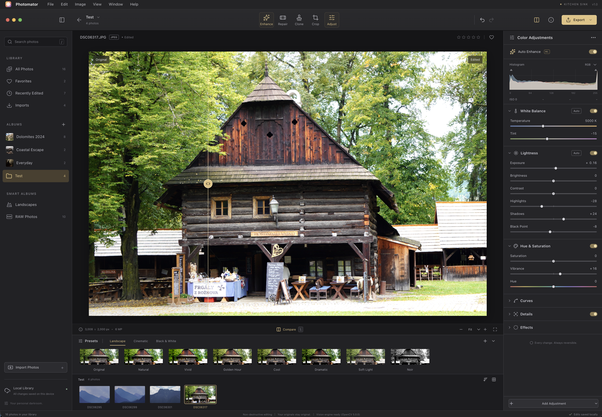

# f/8

f/8 is a photo editor for macOS with ML functions.

The original design is by *GPT 6 Astra*. Follow-up work is by *Muse Spark 1.3*.

## Functions

Library:

- Store photos in albums on your computer.
- Mark favorites and star ratings.
- Search by text or by image content.
- Use smart albums and a resizable grid.

Adjust:

- Use 14 built-in presets, or make your own.
- Change temperature, tint, lightness, hue, saturation, vibrance, detail, tone, grain, vignette, and fade.
- Watch a live RGB histogram.
- Use one-click Enhance, ML scene enhance, ML face enhance, and ML subject and background enhance.
- Copy adjustments from one photo and paste them to another.

Find problems:

- Find blurry photos and near-duplicate photos at import.
- Remove noise with the ML denoise slider and Auto mode.

Compare and history:

- Undo and redo each change (up to 50 steps).
- Drag the divider to compare before and after.
- Hold `\` to see the original photo.
- Use zoom-in view (Z) to preview the cursor region at 8x in the corner.

Crop and repair:

- Crop, rotate, flip, and straighten. The horizon finder helps you.
- Remove objects with Heal, ML Heal, or Clone.
- Remove people with one click.
- Find dust spots automatically.

Import and export:

- Import with the file picker, drag and drop, or folder import.
- Open camera RAW files at full resolution.
- Export JPEG, PNG, and WebP files. Set size and quality.
- Upscale exports 2x with ML super-resolution.

For full details, read [Features](docs/features.md).

## Start the app

1. Install the Node version from `.nvmrc`.
2. Run `yarn install`.
3. Run `yarn setup` to download the ML models.
4. Run `yarn build` one time.
5. Run `yarn dev`.
6. Open the printed URL in your browser (usually `http://localhost:5173`).

More commands:

- Run `yarn typecheck` to check types.
- Run `yarn test` to run tests.
- Run `yarn workspace @f8/server start` to serve the built app.

For more steps, read [Development](docs/development.md).

## More information

- [Features](docs/features.md) lists all functions in full.
- [Architecture](docs/architecture.md) shows workspaces, files, the server, and settings.
- [Development](docs/development.md) shows how to extend and verify the app.
